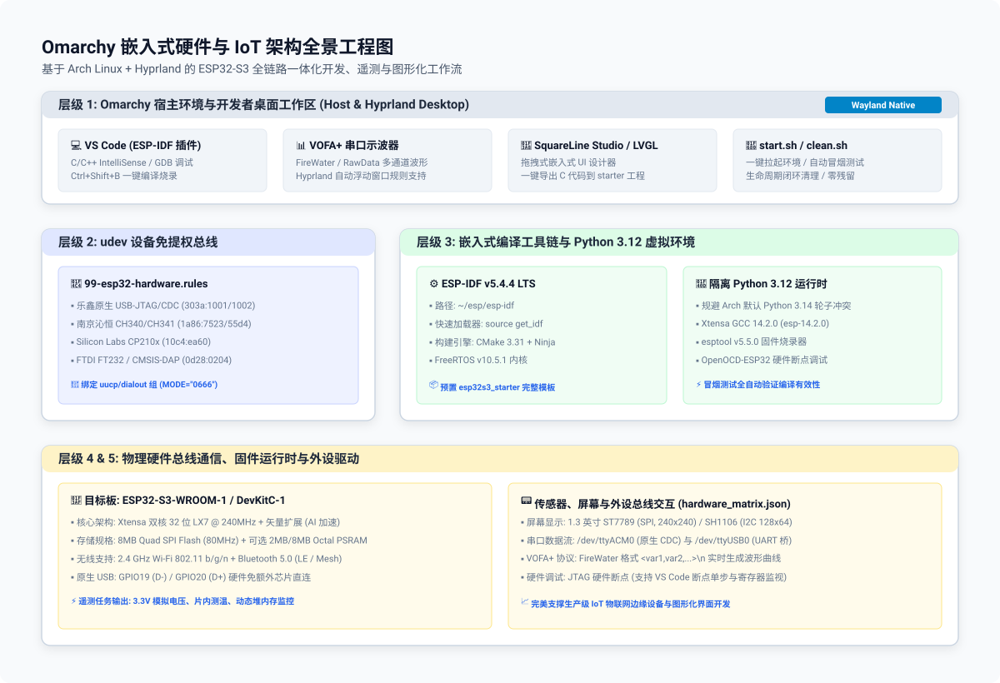
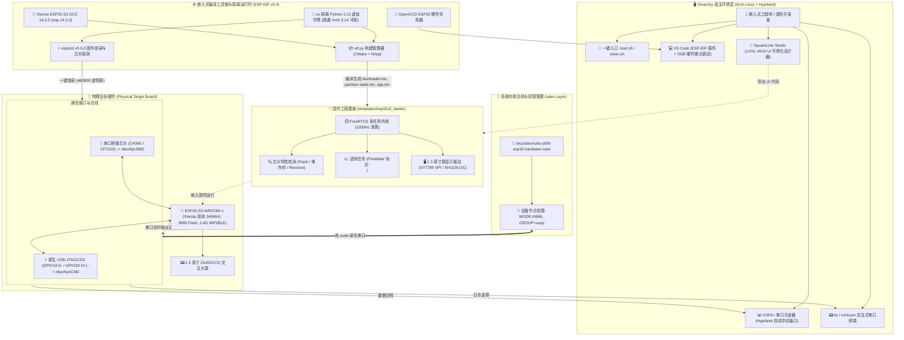

<div align="right">
  <strong>Languages:</strong>
  <a href="README.md">简体中文</a> |
  <a href="README_EN.md">English</a>
</div>

# Omarchy 现代化嵌入式硬件与 IoT 架构规范与使用指南

[](https://github.com/Yotoha0303/Embedded_Hardware_Architecture/actions/workflows/ci.yml)
[](https://github.com/Yotoha0303/Embedded_Hardware_Architecture/releases)
[](LICENSE)
[-1793D1?logo=archlinux&logoColor=white)](https://archlinux.org/)
[](https://github.com/espressif/esp-idf)
[](config/hardware_matrix.json)
[-3776AB?logo=python&logoColor=white)](scripts/setup_esp_idf.sh)
[](https://www.vofa.plus/)

本项目专为 **Omarchy (Arch Linux + Hyprland)** 系统定制，采用**现代化 Linux 嵌入式开发架构**，提供一键拉起硬件编译环境、外设串口免提权自动化授权、多通道传感器波形可视化分析及固件 CI/CD 验证的完整工程化闭环。

> 📖 **相关指南与手册**：
> - 📘 [**用户使用说明书 (USER_GUIDE.md)**](USER_GUIDE.md)：面向硬件与固件开发者的完整实战指南（快速上手、硬件引脚接线、VOFA+ 协议解析、SquareLine Studio UI 移植、FAQ）
> - 🛠️ [**脚本使用手册 (脚本使用手册.md)**](脚本使用手册.md)：每个脚本的底层参数、执行流程、安装产物与复原机制说明
> - 📝 [**版本更新日志 (CHANGELOG.md)**](CHANGELOG.md)：从 v1.0.0 到最新版本的核心特性与架构演进记录

---

## 一、架构层级与组件映射

| 层级 | 工具与组件 | 实际部署形式 | 对应目录与配置文件 |
| :--- | :--- | :--- | :--- |
| **1. 宿主环境与桌面工具** | VS Code (ESP-IDF 插件), VOFA+ 串口示波器, SquareLine Studio, tio/minicom | Omarchy (Arch + Hyprland) 原生集成 | `scripts/setup_host_tools_omarchy.sh`<br>`.vscode/tasks.json`, `.vscode/settings.json` |
| **2. 设备权限与总线免提权** | Linux udev 规则, uucp/dialout 用户组映射 | 宿主机内核事件管理器 | `config/99-esp32-hardware.rules`<br>`scripts/setup_udev_rules.sh` |
| **3. 编译器与隔离运行时** | ESP-IDF v5.4.4 LTS, Xtensa GCC 14.2.0, OpenOCD-ESP32, esptool, Python 3.12 (uv) | 隔离虚拟环境 (`~/.espressif/python_env`) | `scripts/setup_esp_idf.sh`<br>`~/.local/bin/get_idf` |
| **4. 硬件目标与外设定义** | ESP32-S3 (Xtensa 双核 LX7 @ 240MHz, 8MB Flash), Native USB-CDC/JTAG, CH340/CP2102 | 硬件开发板与外设总线 | `config/hardware_matrix.json`<br>`templates/esp32s3_starter/sdkconfig.defaults` |
| **5. 固件工程与数据流模板** | FreeRTOS 实时调度, 硬件检测, VOFA+ FireWater 遥测任务, LVGL 驱动接口 | C/CMake 固件工程标准模板 | `templates/esp32s3_starter/main/main.c`<br>`templates/esp32s3_starter/CMakeLists.txt` |
| **6. 自动化冒烟测试与 CI** | 本地 6 项指标评分卡、GitHub Actions 云端编译流水线 | Shell 自动化脚本 + 容器化构建 | `scripts/smoke_test.sh`, `start.sh`, `clean.sh`<br>`.github/workflows/ci.yml` |

### 架构全景与数据流图 (Architecture & Data Flow)

<p align="center">
  
</p>

<details open>
<summary><b>🔍 点击展开 / 收起交互式 Mermaid 架构全景流向图 (Interactive Mermaid Diagram)</b></summary>



</details>

#### 🔍 架构核心数据流与关键技术选型检索表 (Architecture & Tech Stack Keyword Matrix)

> **SEO 索引与技术规格说明**：为解决图形化流程在搜索引擎爬虫中“不可检索”的问题，以下表格对架构全景图中的核心技术组件、通信协议、服务端口及检索关键词进行结构化索引：

| 核心组件 / 服务名称 | 英文检索关键词 (Keywords) | 部署层级与形态 | 通信协议与端口 | 职责与技术特性 |
| :--- | :--- | :--- | :--- | :--- |
| **Omarchy 宿主工作区** | `Omarchy`, `Arch Linux`, `Hyprland`, `Wayland`, `ESP32 DevEx` | 宿主机桌面环境 | Wayland / PipeWire / D-Bus | 提供平铺式 Wayland 窗口管理，针对 VOFA+ 与烧录监视窗口配置专属浮动规则与快捷工作区 |
| **udev 免提权总线规则** | `udev rules`, `99-esp32-hardware.rules`, `uucp group`, `USB-CDC` | 内核设备层 (`/etc/udev/rules.d/`) | Linux Kernel uevent | 匹配 CP210x, CH340, FTDI, 原生 USB-JTAG (303a:1001/1002)，赋予 0666 与 `uucp` 组，彻底免提权 `sudo` |
| **Python 3.12 隔离环境** | `Python 3.12`, `Astral uv`, `PEP 668`, `Arch Python Incompatibility` | 语言运行时 (`~/.espressif/python_env`) | CLI / venv | 规避 Arch Linux 最新 Python 3.14 无法编译 C 扩展 wheels 的问题，由 `uv` 极速拉取并专供 ESP-IDF |
| **ESP-IDF v5.4.4 LTS** | `ESP-IDF v5.4`, `Xtensa GCC 14`, `CMake`, `Ninja`, `FreeRTOS` | 交叉编译工具链 (`~/esp/esp-idf`) | GCC 14.2.0 / CMake | 乐鑫官方最新长期支持版，原生支持 ESP32-S3 双核 LX7 架构、矢量 DSP 扩展与硬件 USB-JTAG 调试 |
| **原生 USB-JTAG/CDC** | `Native USB-JTAG`, `USB-CDC`, `GPIO19`, `GPIO20`, `/dev/ttyACM0` | 硬件直接通信通道 | Full-Speed USB (12Mbps) | 免额外 USB 转串口芯片，直连 S3 内部 USB 外设，同时支持硬件 GDB 断点单步与 2MB/s 高速串口传输 |
| **VOFA+ 实时串口示波器** | `VOFA+`, `FireWater Protocol`, `Serial Plotter`, `Real-time Waveform` | 宿主桌面应用 (`vofa-plus-bin`) | RawData / FireWater 文本协议 | 接收 `<VDD,Temp,Heap>\n` 格式数据，实时渲染高帧率电压、温度与内存消耗曲线，支持动态滤波与导出 |
| **SquareLine Studio & LVGL** | `SquareLine Studio`, `LVGL v8`, `LVGL v9`, `ST7789`, `SH1106` | UI 设计与显示框架 | SPI / 8080 并口 / I2C | 嵌入式触控与 UI 界面设计器，一键导出适配 1.3 英寸屏幕 (240x240 / 128x64) 的 C 语言 UI 代码 |
| **生命周期闭环脚本** | `start.sh`, `clean.sh`, `smoke_test.sh`, `Health Scorecard` | 自动化运维脚本 (`scripts/`) | Bash / POSIX Shell | 随开随用、用完即净；`start.sh` 自动跑完 6 大层级，`smoke_test.sh` 输出 100% 满分架构评分卡 |

---

## 二、宿主环境部署入口 (Omarchy / Arch Linux 专属与通用 Linux)

在 Omarchy (Arch Linux + Hyprland) 系统中，本项目利用 `pacman` 与 `yay` 统一接管嵌入式宿主工具，无需繁琐编译：

### 🐧 Omarchy (Arch Linux) 一键安装宿主工具
进入项目根目录直接执行：
```bash
./scripts/setup_host_tools_omarchy.sh
```
> **该脚本会自动检测并配置**：
> 1. 基础编译工具链 (`cmake`, `ninja`, `libusb`, `esptool`)
> 2. 高效轻量串口交互终端 (`tio`, `minicom`)
> 3. 硬件在线调试仿真器 (`openocd`)
> 4. AUR 官方打包的 `vofa-plus-bin` (VOFA+ 串口图形分析器)
> 5. 自动向 `~/.config/hypr/hyprland.conf` 追加 VOFA+ 专用窗口浮动规则

若您仅希望**检查**安装状态而不做任何修改，使用 `--check` 选项：
```bash
./scripts/setup_host_tools_omarchy.sh --check
```

---

## 三、快速开始指南（一键拉起与全流程跑通）

### 一键启动入口（严格按照 6 大架构层级映射）

| 平台 | 入口 | 行为 |
| :--- | :--- | :--- |
| **Omarchy (Arch Linux)** | `./start.sh` 或<br>`bash start.sh` | 【层级 1: 总线权限】(配置 `99-esp32-hardware.rules` 并校验用户串口组权限)<br>【层级 2: 宿主工具】(检测 `esptool`, `tio`, `openocd`, `vofa+`)<br>【层级 3: 编译器运行时】(验证 Python 3.12 虚拟环境与 ESP-IDF v5.4.4)<br>【层级 4: 硬件配置】(加载 `config/hardware_matrix.json` 引脚与芯片规范)<br>【层级 5: 固件冒烟测试】(全自动编译 `esp32s3_starter` 并输出架构评分卡)<br>【层级 6: IDE 联动】(可选通过 `--code` 唤起 VS Code 附着开发) |

网络环境：支持国内镜像 / 官方源自动探测与缓存。

自动探测规则：探测 GitHub 上游连通性，若直连超时则自动回退至乐鑫 Gitee 镜像 (`dl.espressif.cn`)。也可通过 `--mirror cn` 强制指定。

```bash
# 完整拉起并执行 6 项自动化冒烟测试 (推荐)
./start.sh

# 强制使用国内镜像源加速
./start.sh --mirror cn

# 仅配置环境与工具，跳过固件编译
./start.sh --up-only

# 配置完成后立即打开 VS Code 开展开发
./start.sh --code

# 指定针对 ESP32-C3 架构初始化
./start.sh --target esp32c3
```

常用参数对照：
* `--mirror auto|cn|global`：下载镜像策略（默认 `auto` 自动探测）
* `--skip-tests` / `--up-only`：仅拉起并配置环境，跳过固件编译冒烟测试
* `--skip-host-tools`：跳过宿主桌面工具检测与安装
* `--tools-only`：仅配置宿主工具与 udev 权限，不执行测试
* `--code`：配置完毕后自动唤起 VS Code 打开工程
* `--target esp32s3|esp32c3`：指定目标硬件架构（默认 `esp32s3`）

### 一键清理入口（随开随用、用完即净）

开发测试完成后，执行以下命令即可实现环境生命周期的完整闭环（清理编译输出、释放缓存）：

| 平台 | 入口 | 说明 |
| :--- | :--- | :--- |
| **Omarchy / Linux** | `./clean.sh` | 快速清理固件 `build/` 目录与二进制镜像文件 |
| **深度清理** | `./clean.sh -a` | 深度清理，包含重置 `sdkconfig`、清空 `ccache` 缓存及 Python 临时文件 |

---

## 四、安装成功手动检查指南 (逐项排查清单)

如果您想手动验证每一个层级与工具是否安装成功、开发板是否正常通信，可参考以下排查步骤：

### 0. 一键快速自动诊断（推荐）
在终端中直接运行自验脚本，自动输出 6 项关键指标评分卡：
```bash
./scripts/smoke_test.sh
```
> 输出示例：
> ```text
> =================================================================
>  📊 嵌入式架构健康评分卡 (Architecture Health Scorecard)
> -----------------------------------------------------------------
>  总计指标: 6 项 | 通过指标: 6 项
>  架构就绪度评级: 100% (A 级硬件开发流水线)
> =================================================================
> 🎉 冒烟测试全部通过！开发环境已达生产交付就绪状态。
> ```

---

### 1. 逐层手动检查对照表

| 架构层级 | 待校验组件 | 手动检查命令 (终端执行) | 预期输出 / 正常现象 |
| :--- | :--- | :--- | :--- |
| **层级 1: 宿主工具** | **esptool 烧录器** | `esptool version` | 输出 `esptool.py v5.x.x` |
| | **tio 串口终端** | `tio -v` | 输出 `tio v3.x` 版本信息 |
| | **OpenOCD 仿真器** | `openocd --version` | 包含 `Open On-Chip Debugger` 版本信息 |
| | **VOFA+ 串口示波器** | `pacman -Qi vofa-plus-bin` | 状态显示为已安装，终端可直接输入 `vofa+` 启动界面 |
| **层级 2: 设备权限** | **udev 规则文件** | `cat /etc/udev/rules.d/99-esp32-hardware.rules \| head -n 8` | 文件存在且包含 CP210x、CH340 及 303a 设备规则 |
| | **用户组权限** | `id -nG \| grep uucp` | 输出中必须包含 `uucp` 用户组 |
| **层级 3: 编译器运行时** | **Python 3.12** | `~/.espressif/python_env/idf5.4_py3.12_env/bin/python --version` | 输出 `Python 3.12.x` |
| | **Xtensa GCC 14** | `source get_idf && xtensa-esp-elf-gcc --version` | 输出 `xtensa-esp-elf-gcc (crosstool-NG esp-14.2.0) 14.2.0` |
| | **IDF 构建工具** | `source get_idf && idf.py --version` | 输出 `ESP-IDF v5.4.4` |
| **层级 4: 硬件通信总线** | **串口设备挂载** | `ls -la /dev/ttyACM* /dev/ttyUSB*` | 显示设备节点（如 `/dev/ttyACM0`），权限为 `crw-rw-rw-` |
| | **芯片硬件探测** | `esptool --port /dev/ttyACM0 chip_id` | 正常探测并打印 `Detecting chip type... ESP32-S3` 与 MAC 地址 |
| **层级 5: 固件模板** | **固件构建测试** | `cd templates/esp32s3_starter && idf.py build` | 终端提示 `Project build complete. To flash, run: idf.py flash` |
| | **产物完整性** | `ls -lh templates/esp32s3_starter/build/*.bin` | 生成 `esp32s3_starter.bin` (约 180KB) |
| **层级 6: 持续集成** | **本地自动化流水线** | `./scripts/smoke_test.sh` | 6/6 全绿通过，评级 100% |

---

## 五、开源许可证 (License)

本项目采用 [Apache License 2.0](LICENSE) 开源许可证。商业友好，允许自由修改、分发及商业应用。
